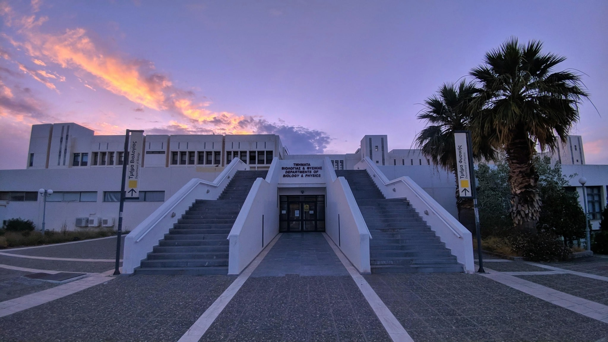
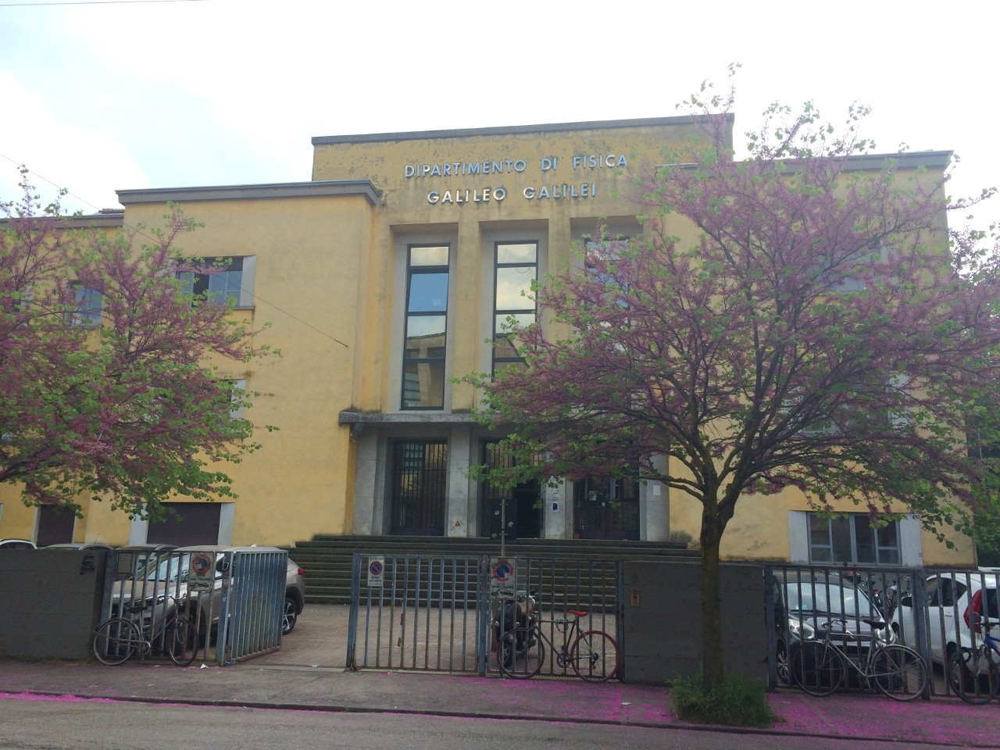

<section class="sj-hero">
  
Education

  <h1 class="sj-title">From physics to hardware and AI</h1>
  
A physics degree in Crete, a Master's in Physics of Data in Padova, and a PhD in the National Programme in Technologies for Fundamental Research in Physics and Astrophysics.

  
<a class="sj-btn" href="/assets/cv/CV_Sapkas_Michail.pdf" target="_blank">Download CV (PDF)</a>

</section>

  
<small>Nov 2024 &ndash; present</small><h4>PhDNational PhD Programme in Technologies for Fundamental Research in Physics and Astrophysics, University of Padova (Computing curriculum, cycle 40)</h4>

  
<small>Oct 2022 &ndash; Sep 2024</small><h4>MScPhysics of Data, University of Padova. Thesis: Beam Control with Fast Reinforcement Learning Inference at the Edge, carried out at KIT, Karlsruhe.</h4>

  
<small>Mar &ndash; Aug 2024</small><h4>ResearchVisiting researcher, Institute for Data Processing and Electronics (IPE), Karlsruhe Institute of Technology (KIT)</h4>

  
<small>Oct 2021 &ndash; Apr 2022</small><h4>ResearchUndergraduate research fellow, FORTH (Heraklion), acoustic propagation models for ship-traffic noise</h4>

  
<small>Sep 2013 &ndash; Apr 2022</small><h4>BScPhysics, University of Crete, Heraklion. Thesis: Gaussian Beam Tracing in Underwater Acoustics (grade 10/10).</h4>

<strong>Doctoral courses</strong>

  
<h3>Deep Neural Networks</h3>
Prof. Giorgio Carlo Buttazzo &middot; passed

  
<h3>Big Data Modelling and Learning</h3>
Prof. Ester Pantaleo &middot; passed

  
<h3>Introduction to Neuromorphic Computing</h3>
Prof. Andrea Duggento &middot; passed

  
<h3>Programmable SoC for Data Acquisition</h3>
Prof. Andrea Fabbri &middot; passed

<strong>Where I studied</strong>

  

    
    
The University of Crete at Voutes, Heraklion. There I ran more than 30 laboratory experiments and first met machine learning.

  

  

    
    
The Dipartimento di Fisica e Astronomia &ldquo;G. Galilei&rdquo;, University of Padova, where I learned to program FPGAs.

  

  

    
    
The KARA control room at KIT, where my master's work on reinforcement learning for beam instabilities took place.

  

[1] Image credit: University of Crete, Google Maps. [2] Image credit: INFN Padova.

