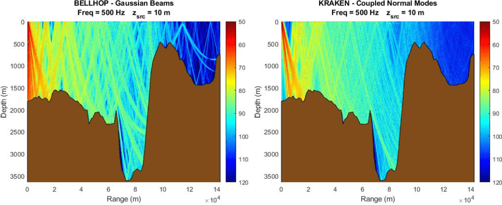

---

title: "Portfolio"
permalink: /portfolio/
description: "Short description of my past projects and work followed by links to the full descriptions in github repositories"
layout: single
---
___________________

Showcase of my work or projects here.

# Master Thesis
### [Beam Control with Fast Reinforcement Learning Inference at the Edge](\assets\thesis\Sapkas_Michail_Beam_Control_with_Fast_Reinforcement_Learning_Inference_at_the_Edge.pdf){:target="_blank"}

- Trying to modulate the RF cavity of a Synchrotron Light Source by leveraging Reinforcement Learning, resulted in a hardware implementation of a model that belongs to the family of Recurrent Neural Networks (RNNs), the Gated Recurrent Unit (GRU). The implementation was realized on the Versal AI Engine, which is a novel architecture launched by AMD Xilinx and extremely efficient in performing the main numerical operations needed by the model, namely Matrix - Vector multiplications.

- RNNs have been designed to handle time series, and they are the perfect candidates to handle this kind of task. Although RNNs don't parallelize well, their ability to distill input and pass information into the hidden state, could be beneficial for real time control tasks.

- I will firstly introduce the AI Engine and its features. Second, I will introduce the GRU cell, the main numerical operations and the constraints introduced by RNN models. Then I will show how numerical operations are being implemented in the AI Engine and its memory limitations. Finally, I will discuss how we tackled the lack of built-in activation functions, since the tanh and sigmoid function implementations are needed.

___________________

# Distributed Computing using four Nvidia Jetson Nanos

This project is a demonstrator for the use of **distributed computing** for physics simulations by connecting four Jetson Nano devices via a network switch and leveraging **Dask** to distribute computational loads.

Two simulations were implemented:

- 2D Ising Model: The simulation models the evolution of a spin lattice using the Metropolis algorithm, where multiple grids are distributed across multiple computing nodes, enabling parallel updates.

- 1D Particle Chain: A thermodynamic simulation of a 1D chain of particles, where various physical properties (e.g. energy, temperature) are computed, by simulating a huge chain with smaller parallel subchain chunks.

___________________

# Bachelor Thesis
### [Gaussian Beam Tracing in Underwater Acoustics](\assets\thesis\Gaussian Beam Tracing in Undewater Acoustics - Theory and Applications - Michail Sapkas.pdf){:target="_blank"}

- Underwater acoustics is the study of sound in water, typically using hydrophones to detect pressure variations or actively generating sound for information acquisition. Unlike electromagnetic waves, sound propagates effectively in water, making it valuable for applications such as seismology, biological monitoring, ocean temperature measurement, and underwater communication.

- Ray tracing, a method used to model sound propagation, has been extensively developed, with the BELLHOP program.

- This thesis explores ray tracing modeling, beginning with fundamental concepts in underwater acoustics, followed by a heuristic and mathematical approach to geometrical ray tracing, connecting it to wave equations and Gaussian beam extensions. While ray tracing offers computational advantages, it is a high-frequency approximation with limitations, which can be mitigated by Gaussian beam methods. The study benchmarks BELLHOP against the KRAKEN normal mode program through test cases, including real-world data, to evaluate its effectiveness in complex underwater environments.

___________________
