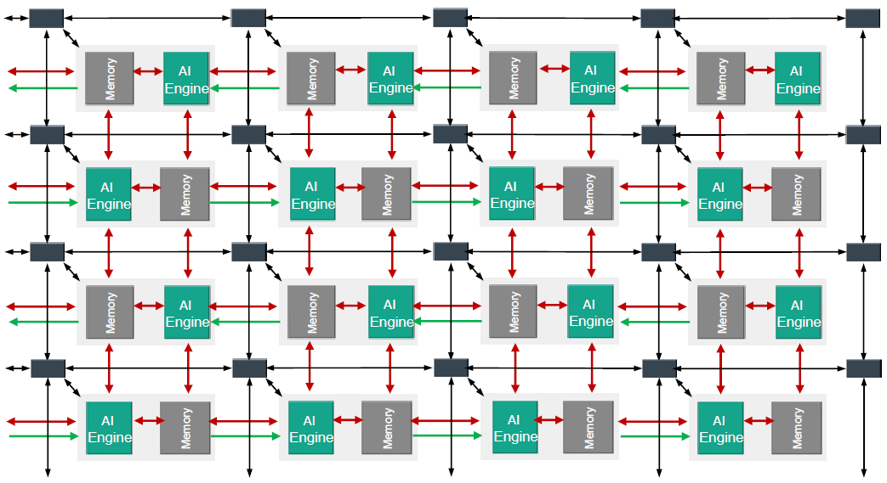
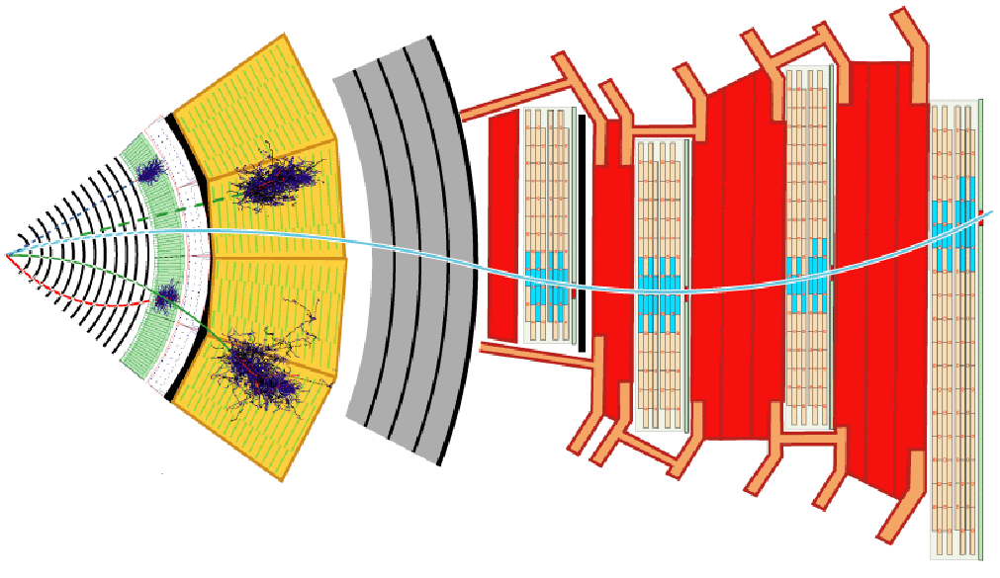

---
header:
  title: "Current Research Interests"
description: "My current academic pursuits and research interests"
layout: single
permalink: /research/
---

A brief introduction on the topics that I am currently working on. 

___________________

# AMD Xilinx Versal AI Engine

 
[1] A graphical representation of the AI Engine Array. 

 

With the rise of Artificial Intelligence came also an ever increasing need to compute specialized tasks better, 
faster and more. To tackle the challenges that arise with this new type of workload, AMD Xilinx proposes the Versal 
Adaptive Computing Accelerating Platform (ACAP). A new accelerator module has been introduced, a 2D array of 400 tiles, 
the AI Engine, which moves away from the Von Neuman architecture by placing memory and vectorized cores in the same unit (tile). 
The tiles communicate with interconnects and memory sharing, and the whole Array can access PL resources via interfacing tiles. 
We explore the capabilities of the AI Engine for physics applications at the edge.

# Particle Flow for the CMS Trigger 

 
[2] Particles that interact (aka "Collide") at the crossing of the proton beams, create a shower of particles
that travel through the CMS sub detectors. First the Inner Tracker, then the Calorimeters and finally the Muon detector. We 
need to be able to Trigger Data Acquisition in less than the collision rate, which is 25 nanoseconds. 

 

High Energy Physics experiments are a clear instance of extreme application for computing. They require the uttermost latency constraints and reliability. One suitable algorithm to run on the AI Engine is the CMS Triger Particle Flow, which aims to link together the physical objects seen by the subdetector systems. Until now, this task has been done in software in the High Level Trigger, at a rate of 100KHz, but with the phase 2 upgrade of CMS we are targeting to bring it at the timing of 40 MHz, the same pace as the collisions.

# A Gated Recurrent Unit implementation for the AI Engine

 
The Gated Recurrent Unit (GRU) Cell is a graphical representation of the numerical operations of the model. [3] 

 

Physics experiments can greatly benefit from inference models, either for detection or for active control of the experiment itself. In collaboration with KIT IPE, we explored an approach to controlling a Synchrotron Light Source using Reinforcement Learning, leading to the implementation of a Gated Recurrent Unit in AI Engines. RNNs are perfect candidates for this specific task, since they work by distilling and compressing input information in their hidden state, which serves as memory. This way, we can feed small context windows of input observations to a lightweight model, very fast, respecting the memory and latency constraints of the problem.

_________________________________________________________

 
[1] AI Engine Image Credit: introduction_to_the_versal_acap_ai_engine_and_to_its_programming_model_20230428.pdf 

 
[2] Particle Flow Image Credit: https://cms-opendata-workshop.github.io/workshop2023-lesson-physics-objects/aio/index 

 
[3] Gated Recurrent Unit Image Credit: https://www.researchgate.net/figure/Gated-Recurrent-Unit-GRU_fig3_331848495 

