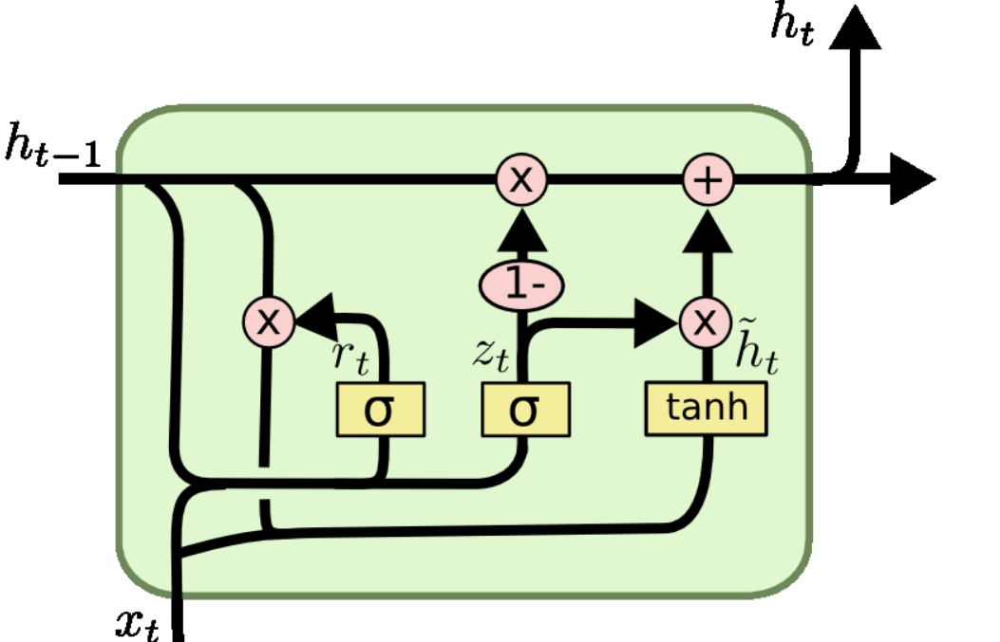
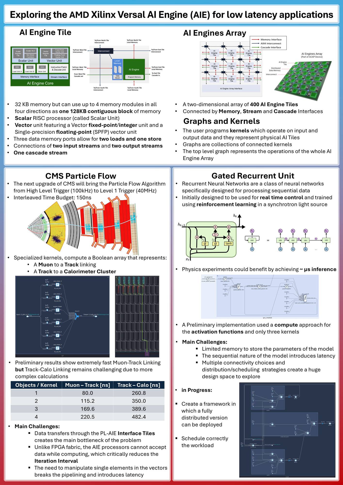

<section class="sj-hero">
  
Current research

  <h1 class="sj-title">Machine learning at the edge of the detector</h1>
  
Physics experiments generate data faster than it can be stored. My work is about putting neural networks directly into the readout chain, on FPGAs and AI Engines, so that decisions are made in nanoseconds.

</section>

  

    Hardware
    <h3>GRU on the AMD Versal AI Engine</h3>
    
A Gated Recurrent Unit designed for latency-constrained inference on the VCK190. The design uses row-wise matrix-vector products, a hybrid AIE and programmable logic dataflow, and look-up tables for tanh and sigmoid.

    Published, JINST 2026AIERNN
  

  

    Detector
    <h3>1D CNN trigger for a CAEN digitizer</h3>
    
A three-layer CNN that flags particle hits in digitizer waveforms. It is converted to VHDL with HLS4ML at fixed-point precision, integrated with a 32-comparator hit-map output, and closes timing at 8&nbsp;ns with a 182-cycle latency.

    In progressHLS4MLFPGA
  

  

    Detector
    <h3>Mini Drift Tubes muon telescope</h3>
    
Machine learning for muon tracking and timing (GRU and Transformer models), plus a time-to-digital pipeline on an Artix UltraScale+ FPGA with XDMA/PCIe readout, for the telescope mounted at the Padova Quantum Lab.

    In progressTDCPCIe
  

  

    Accelerators
    <h3>Reinforcement learning for accelerators</h3>
    
Control of beam instabilities at the KARA synchrotron light source, with a small recurrent agent deployed on hardware. Presented at the RL4AA'26 collaboration workshop.

    RLKARA
  

<h2>Why recurrent networks on AI Engines?</h2>

Recurrent networks are a natural fit for detector and control problems because they compress what they have seen into a hidden state. That state is also what makes them hard to accelerate: each step depends on the one before it. The AI Engine's vector processors and local memory let me spread those matrix-vector products across tiles, which keeps the latency low without quantizing the model.

!<a href="/assets/images/aie_array-min.png">The AI Engine array</a>

 A graphical representation of the AI Engine array. 

<h2>CMS Trigger Particle Flow</h2>

Particle Flow links the objects seen by the CMS sub-detectors. Today it runs in software in the High Level Trigger at about 100 kHz. With the Phase-2 upgrade the target is to run it at the 40 MHz collision rate, which makes it a strong candidate for hardware acceleration.

!<a href="/assets/images/pf_cms-min.png">Particle Flow in CMS</a>

Particles that collide at the crossing of the proton beams create a shower that travels through the CMS sub-detectors. Image credit: CMS Open Data workshop.

  

    
    
The Gated Recurrent Unit cell, the model at the heart of my AI Engine work. Image credit: ResearchGate.

  

  

    
    
A poster from one of my recent presentations.

  

