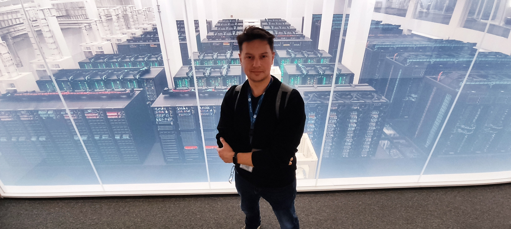

# Welcome to My Personal Page  

## About Me  
I am **Michail**, a trained physicist and a **PhD student** at the **University of Padova**.

  

Visiting Mare Nostrum 5 at the Barcelona Supercomputing Center.

## Research and Work  
I am part of the [BOOST Lab](http://boostlab.dfa.unipd.it), where our main focus is **particle physics** and, in particular, the **CMS experiment at CERN**. Additionally, I explore the potential of **hardware accelerators for AI applications** at the edge for physics experiments.  

If you'd like to know more about my **skills and educational background**, visit the [Education](/education) page.  

## Current Projects  
I am currently working with:  
- **Versal AI Engine**  
- **VCK190 Evaluation Board**  
- **Vitis Unified Software Platform**  

My research includes developing algorithms like the **CMS Trigger Particle Flow** and implementing **AI models** such as the **Gated Recurrent Unit (GRU)**.  

To learn more, visit my [Current Research Interests](/research) page.  

  

Me and my friend V! in my temporary office at IPE.

