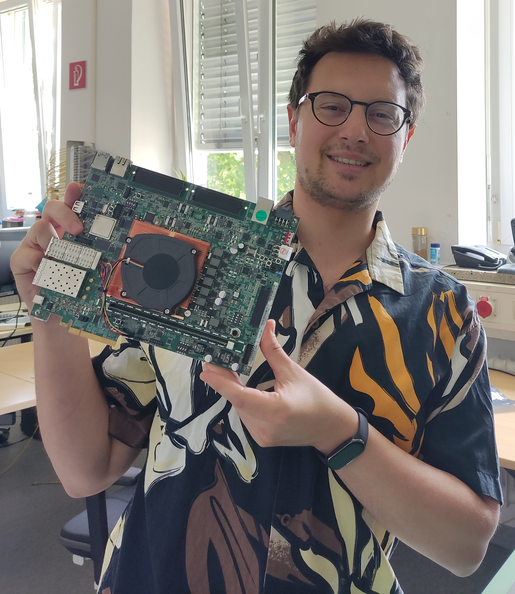
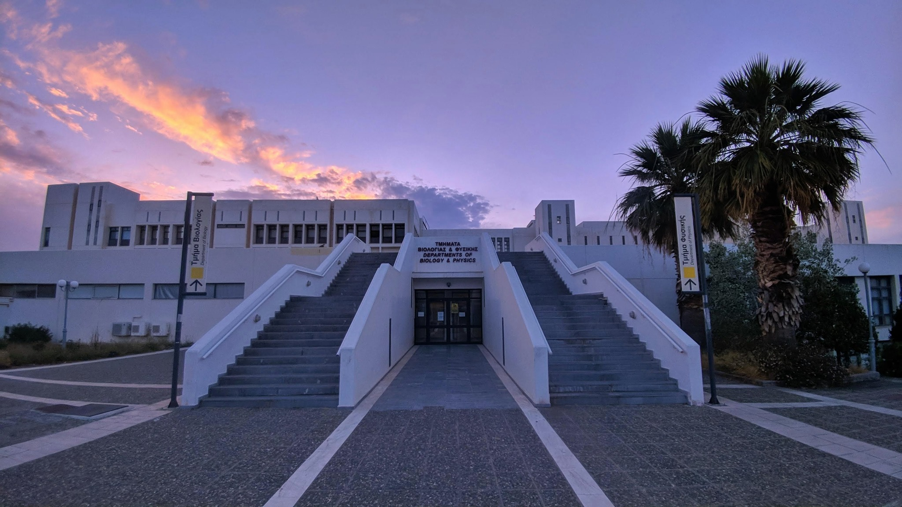

---
---

Welcome to my personal page. I am Michail, a PhD student at the University of Padova. I am part of the 
[BOOST Lab](http://boostlab.dfa.unipd.it), our interest is mainly focused in particle physics and in particular in the 
CMS experiment at CERN, but I am also exploring the capabilities of hardware accelerators for AI applications at the edge for physics
experiments.

I am currently working with Versal AI Engine, the VCK190 evaluation kit, and the Vitis Unified Software Platform to develop algorithms like the CMS trigger **Particle Flow**, and inference models like the **Gated Recurrent Unit (GRU)**.

# Education

I received my **Bachelor's degree in Physics** from the University of Crete, Greece.

In the University of Crete, I had the privilege to learn the classical physics curriculum and also to delve into the modern physics topics. UoC also provided me with the opportunity to conduct more than 30 experiments in the laboratory and to start my first steps in programming with FORTRAN and python. It is also here where I was introduced to Machine Learning and Artificial Intelligence for the first time and it was at this moment that I start contemplating of the potential of these tools in the field of physics.
